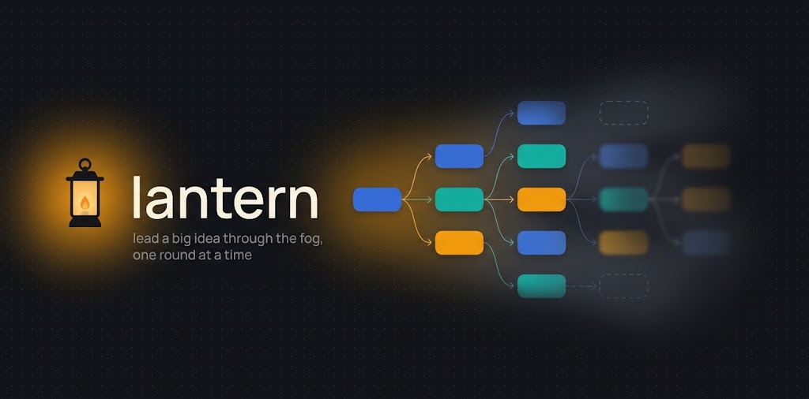
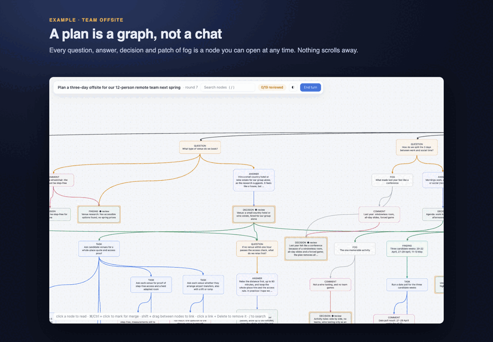

<p align="center"></p>

<p align="center">
  <strong>A round-based brainstorming plugin for Claude Code.</strong><br>
  <a href="LICENSE"></a>
</p>

**lantern helps you think through a big idea with Claude over many sessions.** A map is a graph of goals, questions, findings, decisions, tasks and *fog*: the areas that cannot be pinned down yet. Claude leads, one round at a time. You work in a local web graph, choose where to go deep, and the map stays the shared record of what you learned and decided.

<p align="center"><a href="examples/README.md"></a></p>
<p align="center"><sub>From three example maps. <a href="examples/README.md">Open them yourself</a>.</sub></p>

## Why lantern

lantern grew out of [grill-me](https://github.com/mattpocock/skills), a skill that has the agent interview you about a plan: it walks down each branch of the design tree, one question at a time, with a recommended answer for each. The idea is right: an agent that leads, asks the hard questions and recommends, finds the gaps a plan hides. The medium is the problem. A chat is a line, but a plan is a tree.

What was missing:

- **Every node, reachable.** In a chat, the branch you skipped twenty messages ago is gone in the scrollback. In lantern each question, finding and decision is a node in a graph. You open any node, at any time, and answer, comment or link it to another one. You choose where to go deep; the rest waits.
- **Clear artifacts.** A grilling session ends with a long transcript, and the decisions are buried in it. In lantern, every settled point becomes a `decision` node, and every fact the agent established becomes a `finding` that cites its source. The map itself is the record of what was decided and why.
- **One question at a time is slow, all at once is noise.** lantern plays in rounds. The agent opens at most three new questions per turn, the ones that unblock the most, and parks the rest as fog. Fog turns into sharp questions as the decisions around it land.
- **Many sessions, not one.** A big idea takes days. The map is a JSON file in your project; any new session picks it up where the last one stopped. Closed rounds are locked, so the history can't drift. You can still comment on an old node, and the agent replies.
- **You steer.** You answer in a web UI, not in the chat. You can approve agent nodes, mark them unclear, ask for a merge, focus the whole map on one branch, or put a request on a node: decompose, diverge, reflect, challenge, research, or a worked example.

## How it works

1. **Map the idea.** Run `/lantern:map <idea>`. Claude pins down the destination, such as a spec, a decision or a plan, and opens the first questions and fog.
2. **Explore in the graph.** Run `/lantern:serve` and open the UI. Answer questions, comment, approve, mark nodes unclear, or put a request on a node.
3. **End your turn.** Press **End turn** in the UI.
4. **Claude takes its turn.** Run `/lantern:turn`. Claude reads what you did, replies, adds the next questions, findings or decisions, and closes the round.
5. **Come back any time.** The map stays in your project. Continue tomorrow, next week, or in a new session.

You do not have to review every open node each round. Go deep on one branch and leave the others for later.

## How the agent thinks

grill-me asks; lantern also brainstorms. On each turn the agent names the **bottleneck** of each branch in focus and picks a technique for it:

| Bottleneck | Technique | What you see |
|---|---|---|
| Weak framing, untested assumption | First principles | The problem reduced to what must be true |
| Options or areas are missing | Divergent thinking, morphological analysis | New directions and dimensions |
| Every option is the usual one | Analogies and prior art, through web research | A finding with sources |
| One favourite, never challenged | Pre-mortem, inversion | How the favourite could fail, and the best alternative |
| Many alternatives open | Convergent comparison | A question with a recommended option |
| The branch has landed | Synthesis | A decision |

The methods apply across the whole map, every turn, not only when you ask. They stay behind the scenes: nodes never name a technique, only the result, in plain short sentences. The full rules are in `RULES.md`.

## Examples

Three finished maps, six rounds each: replacing Google Analytics with a self-hosted tool, planning a team offsite, and designing a CLI plugin system. Each ends with a write-up and leaves a few points open, so you can keep playing. See [`examples/README.md`](examples/README.md) for how to open and continue them.

## Install

In Claude Code:

```text
/plugin marketplace add pavelvod/lantern
/plugin install lantern@lantern
```

To work on the plugin itself, run Claude Code with your checkout:

```bash
claude --plugin-dir /path/to/lantern
```

## Commands

| Command | What it does |
|---|---|
| `/lantern:map <idea>` | Chart a new map and its destination |
| `/lantern:turn [slug]` | Play the agent's turn |
| `/lantern:serve [slug]` | Start the web UI on `http://127.0.0.1:8765/` |

Maps live in `<cwd>/.lantern/<slug>.json`. Maps from before the rename, in `.dagmap/`, still open.

Shared rules for every skill: `RULES.md`. CLI and server: `bin/lantern.py`, Python standard library only. UI: `bin/ui.html`.

## Requirements

- Claude Code with plugin support
- Python 3.9 or newer
- A browser with internet access: the UI loads its graph libraries from a CDN

## Tests

```bash
python3 tests/test_lantern.py   # or: python3 -m pytest -q tests, if pytest is installed
```

## Contributing

Bug reports, ideas and pull requests are welcome. The most useful feedback comes from a real problem: try lantern on one, and tell us what worked, what felt awkward, and where the agent should lead better.

## License

MIT, see [`LICENSE`](LICENSE).
