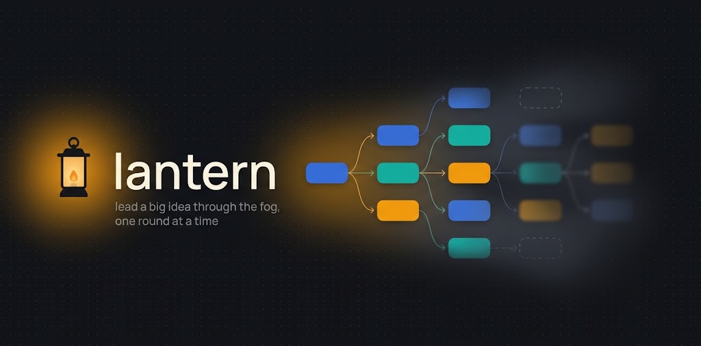

<p align="center"></p>

# lantern

A Claude Code plugin for brainstorming a big idea over many sessions. A map is a DAG of goals, questions, decisions, findings and fog. The user works in a web graph; the agent takes turns through a CLI and leads the user through the fog, a round at a time. Closed rounds are locked, but the user can still comment on them.

## Why lantern

lantern grew out of [grill-me](https://github.com/mattpocock/skills), a skill that has the agent interview you about a plan: it walks down each branch of the design tree, one question at a time, with a recommended answer for each. The idea is right: an agent that leads, asks the hard questions and recommends, finds the gaps a plan hides. The medium is the problem. A chat is a line, but a plan is a tree.

What was missing:

- **Every node, reachable.** In a chat, the branch you skipped twenty messages ago is gone in the scrollback. In lantern each question, finding and decision is a node in a graph. You open any node, at any time, and answer, comment or link it to another one. You choose where to go deep; the rest waits.
- **Clear artifacts.** A grilling session ends with a long transcript, and the decisions are buried in it. In lantern, every settled point becomes a `decision` node, and every fact the agent established becomes a `finding` that cites its source. The map itself is the record of what was decided and why.
- **One question at a time is slow, all at once is noise.** lantern plays in rounds. The agent opens at most three new questions per turn, the ones that unblock the most, and parks the rest as **fog**: the dim view of an area that cannot be pinned down yet. Fog turns into sharp questions as the decisions around it land.
- **Many sessions, not one.** A big idea takes days. The map is a JSON file in your project; any new session picks it up where the last one stopped. Closed rounds are locked, so the history can't drift.
- **You steer.** You answer in a web UI, not in the chat. You can approve agent nodes, mark them unclear, ask for a merge, focus the whole map on one branch, or put a request on a node: decompose, diverge, reflect, challenge, research, or a worked example.

## How the agent thinks

grill-me asks; lantern also brainstorms. On each turn the agent reads what you did, then names the **bottleneck** of each branch in focus and picks a technique for it:

| Bottleneck | Technique |
|---|---|
| Weak framing, untested assumption | First principles |
| Options or areas are missing | Divergent thinking, morphological analysis |
| Every option is the usual one | Analogies and prior art, through web research |
| One favourite, never challenged | Pre-mortem, inversion |
| Many alternatives open | Convergent comparison, with a recommended option |
| The branch has landed | Synthesis into a decision |

The methods apply across the whole map, every turn, not only when you ask. They stay behind the scenes: nodes never name a technique, only the result, in plain short sentences that stand alone. The full rules are in `RULES.md`.

## Skills

| Skill | Use |
|---|---|
| `/lantern:map <idea>` | Chart a new map |
| `/lantern:turn [slug]` | The agent's turn |
| `/lantern:serve [slug]` | Start the web UI on `http://127.0.0.1:8765/` |

Shared rules for every skill: `RULES.md`. CLI and server: `bin/lantern.py` (stdlib only), UI: `bin/ui.html`.

Maps live in `<cwd>/.lantern/<slug>.json`. Maps from before the rename, in `.dagmap/`, still open.

## Install

```
/plugin marketplace add pavelvod/lantern
/plugin install lantern@lantern
```

To work on the plugin itself, run Claude Code with your checkout: `claude --plugin-dir <path to your clone>`.

## Tests

```
python3 tests/test_lantern.py   # or: python3 -m pytest -q tests, if pytest is installed
```

## License

MIT, see `LICENSE`.
