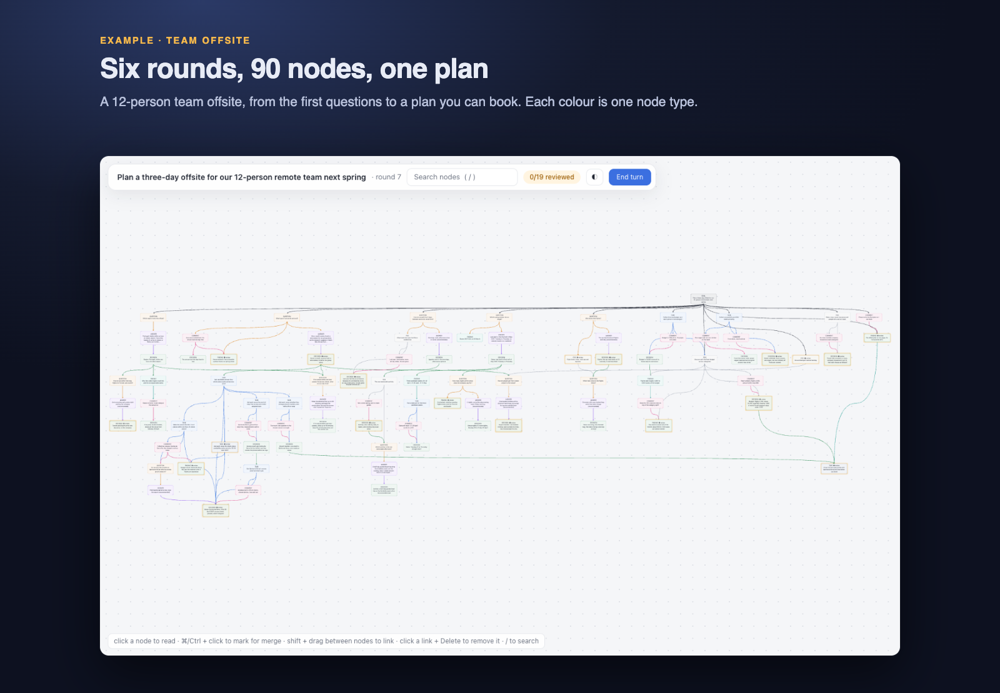
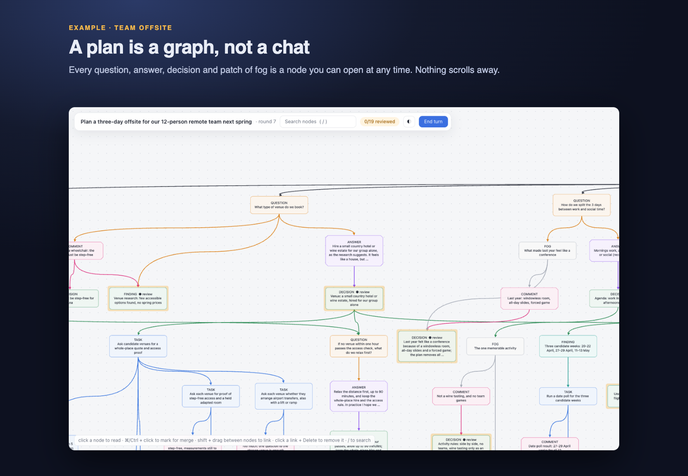
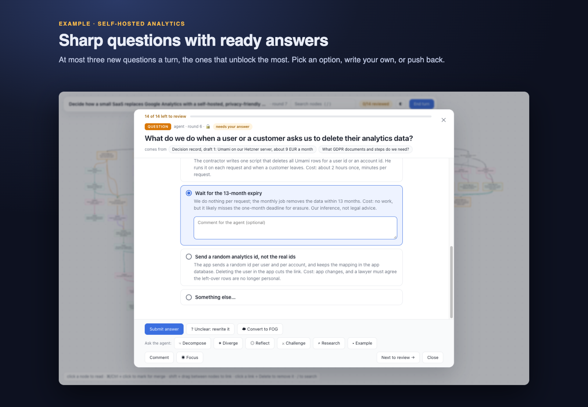
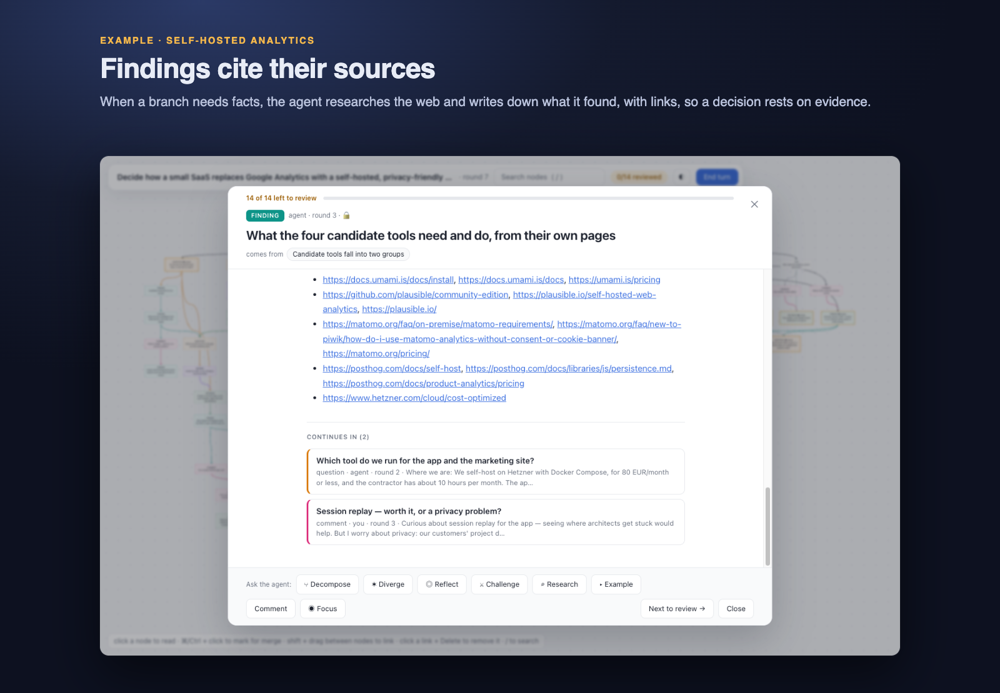
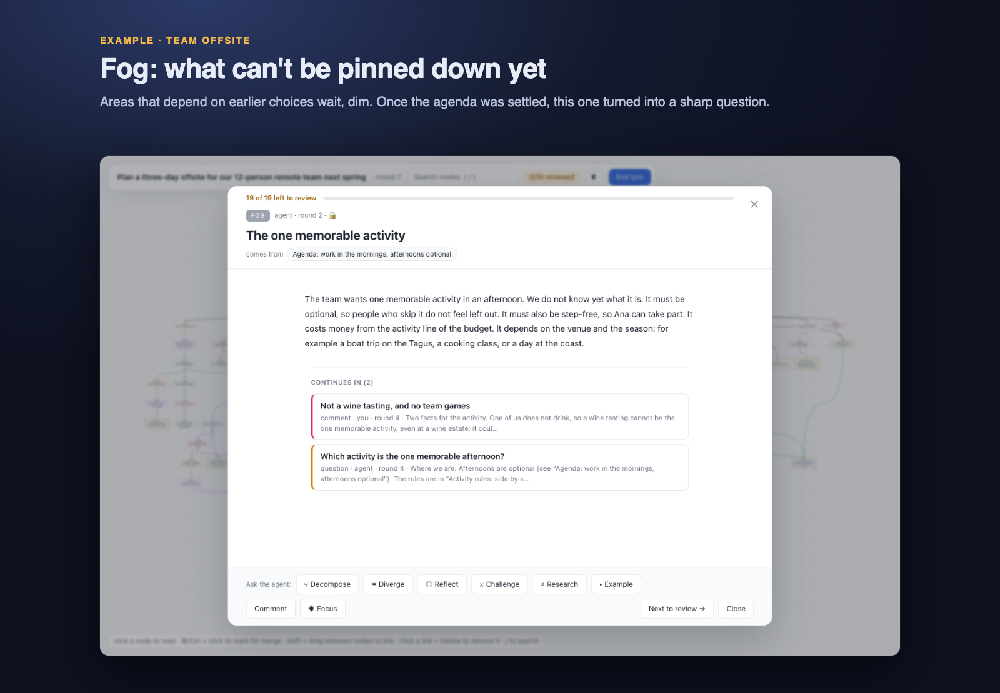
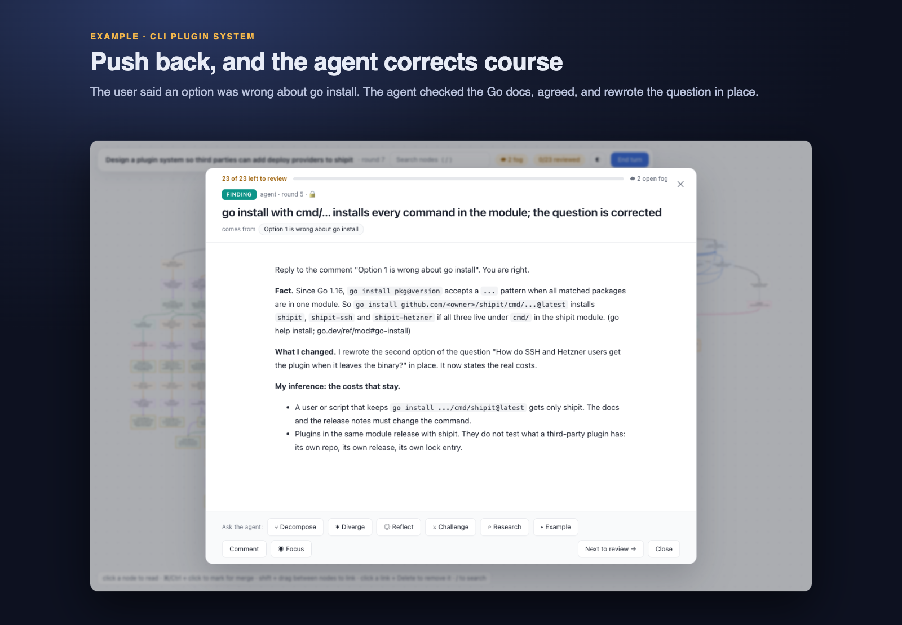
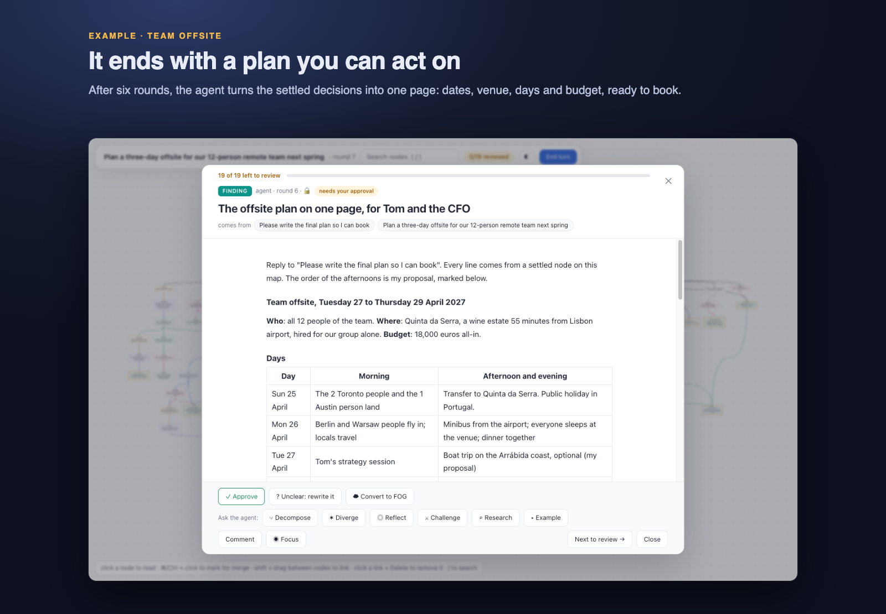
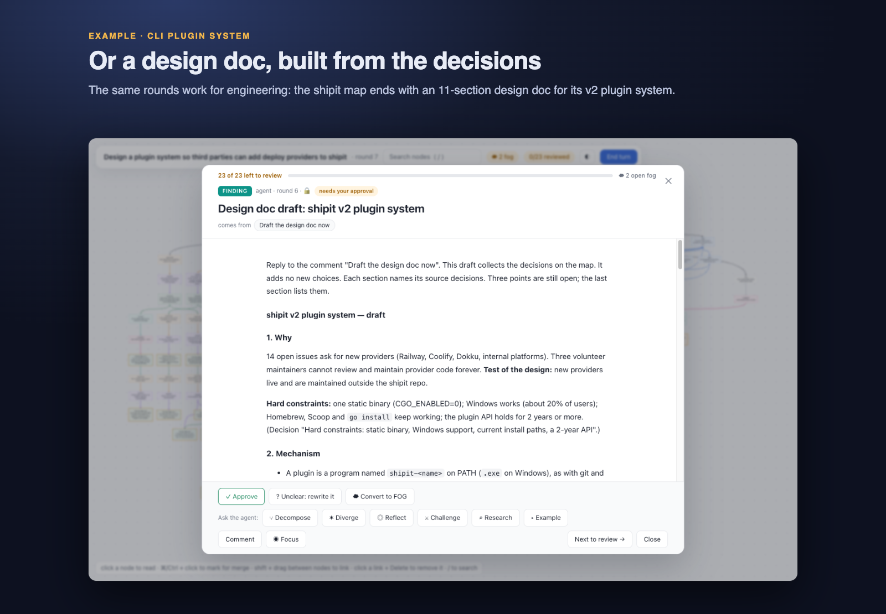

# Example maps

Three finished lantern maps, played over 6 rounds each. An agent played the user, with a persona and facts it held back until asked. Each map ends with a write-up, plus 1 to 3 items left open, so you can keep playing.

| Map | Goal | Ends with |
|---|---|---|
| `self-hosted-analytics.json` | Decide how a small SaaS replaces Google Analytics with a self-hosted, privacy-friendly setup | A decision record: Umami on a Hetzner server, about €9 a month |
| `team-offsite.json` | Plan a three-day offsite for a 12-person remote team next spring | A one-page plan: Quinta da Serra, 27–29 April 2027, €18k budget split |
| `cli-plugin-system.json` | Design a plugin system so third parties can add deploy providers to `shipit` | An 11-section design doc draft |

All three maps are at round 7, and it is the user's turn.

## A tour in screenshots










## Open a map

lantern reads maps from `<cwd>/.lantern/<slug>.json`, and the file name must match the map's slug. Copy the example into a working directory first. Then the UI changes only your copy, not the file in this repo.

Set `LANTERN` to your lantern clone, then run:

```bash
LANTERN=/path/to/lantern
mkdir -p /tmp/lantern-demo/.lantern
cp "$LANTERN/examples/team-offsite.json" /tmp/lantern-demo/.lantern/
cd /tmp/lantern-demo
python3 "$LANTERN/bin/lantern.py" serve team-offsite
```

Open the URL it prints, `http://127.0.0.1:8765/`. If port 8765 is busy, add `--port 0`. The server then picks a free port and prints it.

You can also start the UI from Claude Code. Start Claude Code in `/tmp/lantern-demo`, then run `/lantern:serve team-offsite`.

To read a map without the UI, use the CLI:

```bash
python3 "$LANTERN/bin/lantern.py" outline team-offsite   # the whole map as a tree
python3 "$LANTERN/bin/lantern.py" node team-offsite n90  # one node
```

## Continue a map

Rounds alternate between you and the agent.

1. **Your turn, in the UI.** Click a node. You can answer an open question, comment on any node, approve agent nodes, mark one unclear, or put a request on it: decompose, diverge, reflect, challenge, research or example. Open questions and tasks are a good place to start.
2. Press **End turn**.
3. **The agent's turn.** Start Claude Code in `/tmp/lantern-demo`, with the lantern plugin installed, and run `/lantern:turn team-offsite`. The agent replies to what you did, adds new questions, and closes the round.
4. The open tab shows the agent's turn within a few seconds. Repeat from step 1.

Everything from a closed round is locked. You can still comment on it, and the agent replies on its next turn.

To start over, copy the example again over your working copy.
